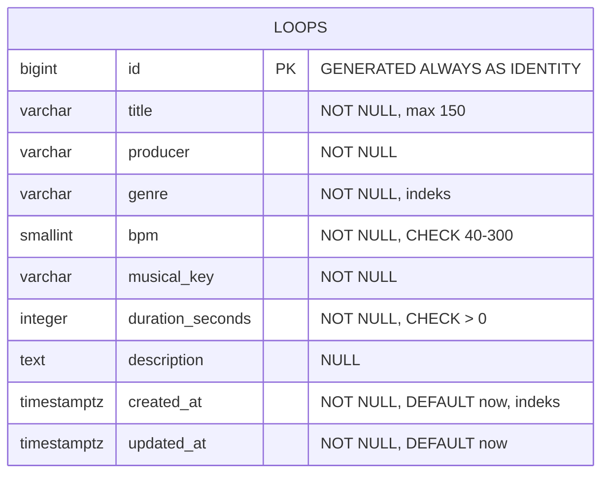

# CookUP+

Projekt zaliczeniowy na przedmiot WDPAI.

CookUP+ to miejsce dla beatmakerów do wymiany pętli audio i wspólnego tworzenia utworów. Jeden użytkownik wrzuca pętlę (np. melodię), inni ją pobierają, dorabiają swoją część (np. perkusję) i odsyłają ją jako collab. Aplikacja umożliwia ciągłe odtwarzanie muzyki podczas przeglądania bazy, łatwe filtrowanie i wgrywanie plików. Ma dwa poziomy kont, automatyczny newsletter, pełną responsywność, tryb ciemny/jasny oraz interfejs po polsku i angielsku.

## Spis treści
- [Funkcje](#funkcje)
- [Role i uprawnienia](#role-i-uprawnienia)
- [Ekrany](#ekrany)
- [Flow aplikacji](#flow-aplikacji)
- [Technologie](#technologie)
- [Architektura](#architektura)
- [Baza danych (ERD)](#baza-danych-erd)
- [Uruchomienie](#uruchomienie)
- [Bezpieczeństwo](#bezpieczeństwo)
- [Dostępność (WCAG)](#dostępność-wcag)
- [Testy](#testy)
- [Checklista wymagań](#checklista-wymagań)

## Funkcje
- Przeglądanie, wyszukiwanie i filtrowanie pętli (gatunek, BPM, tonacja, sortowanie) bez przeładowania strony (Fetch API).
- Odsłuchiwanie pętli w odtwarzaczu na dolnym pasku. Odtwarzacz zapamiętuje utwór i pozycję i wznawia odtwarzanie po przejściu na inną stronę.
- Wgrywanie pętli: plik audio (MP3/WAV) i okładka (JPG/PNG/WEBP). Pliki są zapisywane na serwerze, a w bazie przechowywany jest tylko URL.
- Pobieranie pętli i dodawanie ich do ulubionych.
- Collab: użytkownik wysyła swoją wersję pętli, a właściciel ją akceptuje albo odrzuca. Zaakceptowane collaby są widoczne pod pętlą.
- Profil użytkownika z avatarem, opisem, jego pętlami i ulubionymi.
- Newsletter: raz w tygodniu (CRON + PHPMailer) zapisani użytkownicy dostają maila z pętlami dodanymi w ostatnich 7 dniach.
- Tryb ciemny i jasny, interfejs PL i EN.

## Role i uprawnienia
| Rola | Uprawnienia |
|---|---|
| Gość | przegląda, filtruje i odsłuchuje pętle, widzi profile |
| Starter (domyślna) | wszystko co gość + pobieranie MP3, maks. 5 wgranych pętli, collaby, ulubione |
| Pro | wszystko co Starter + bez limitu pętli, pobieranie WAV |
| Admin | panel administracyjny: zmiana ról i usuwanie użytkowników, usuwanie pętli |

Przejście na Pro odbywa się przyciskiem „Upgrade” na stronie Pricing (bez płatności).

## Ekrany
1. Home
2. Loops - lista z wyszukiwarką i filtrami
3. Szczegóły pętli
4. Upload pętli
5. Collab - przychodzące i wysłane prośby
6. Profil
7. Pricing
8. Logowanie / rejestracja
9. Panel admina
10. Strony błędów (403, 404)

<!-- TODO: dodać zrzuty ekranu (desktop i mobile) -->

## Flow aplikacji
<!-- TODO: opisać główne ścieżki, np.:
1. Gość -> rejestracja -> logowanie
2. Użytkownik -> upload pętli -> pętla widoczna na liście
3. Inny użytkownik -> Request Collab -> właściciel akceptuje -> collab widoczny pod pętlą
-->

## Technologie
- PHP 8.3 (obiektowo, własne MVC i router)
- PostgreSQL
- JavaScript (Fetch API), HTML, CSS
- Docker Compose: nginx, php-fpm, postgres, pgAdmin, mailpit
- Composer: PHPMailer, PHPUnit

## Architektura
1. Nginx przekazuje każde żądanie do `public/index.php` (front controller).
2. W `index.php` są zarejestrowane trasy, np. `$routing->get('/loops/{id}', LoopController::class, 'show')`.
3. `Routing::dispatch()` zamienia każdą trasę na wyrażenie regularne (`{id}` pasuje tylko do cyfr), dopasowuje adres, tworzy kontroler i wywołuje jego metodę z parametrem, np. `show(1)`.
4. Kontroler pobiera dane (docelowo z repozytoriów PostgreSQL) i wywołuje `render()`.
5. `AppController::render()` przekazuje dane do widoku. Widoki korzystają ze wspólnych fragmentów (nagłówek, nawigacja, odtwarzacz).
6. Gdy żadna trasa nie pasuje, wyświetlany jest widok 404 z kodem odpowiedzi 404.

## Baza danych (ERD)
Obecny schemat (PostgreSQL):



<!-- TODO: docelowe relacje, dodawane razem z kolejnymi funkcjami:
    ROLES ||--o{ USERS : has
    USERS ||--o{ LOOPS : uploads
    GENRES ||--o{ LOOPS : categorizes
    USERS ||--o{ FAVORITES : adds
    LOOPS ||--o{ FAVORITES : in
    LOOPS ||--o{ COLLABS : receives
    USERS ||--o{ COLLABS : sends
-->

Schemat bazy: `docker/db/init.sql` - PostgreSQL wykonuje go automatycznie przy pierwszym starcie z pustym wolumenem.
Eksport bazy do pliku .sql: <!-- TODO -->

## Uruchomienie
```bash
cp .env.example .env
docker compose up --build -d
docker compose exec php composer install
# przykładowe pętle (dodawane przez aplikację, uruchomienie drugi raz niczego nie dubluje)
docker compose exec php php scripts/seed-loops.php
```

Podgląd tabeli w bazie:
```bash
docker compose exec db sh -c 'psql -U "$POSTGRES_USER" -d "$POSTGRES_DB" -c "\d loops"'
```
- Aplikacja: http://localhost:8080
- Mailpit: http://localhost:8025

## Bezpieczeństwo
<!-- TODO: opisać realizację security bingo -->
- Hasła hashowane przez `password_hash`.
- Zapytania przez prepared statements (PDO).
- Token CSRF w formularzach.
- Escapowanie danych w widokach (`htmlspecialchars`).
- Regeneracja ID sesji po zalogowaniu, ciasteczka HttpOnly i SameSite.
- Walidacja uploadu: typ MIME, rozmiar, losowa nazwa pliku.
- Uprawnienia sprawdzane po stronie serwera.
- Sekrety w `.env` (poza repozytorium).

## Dostępność (WCAG)
<!-- TODO: wstawić raport (np. Lighthouse / WAVE) -->

## Testy
```bash
docker compose exec -T php vendor/bin/phpunit
```
<!-- TODO -->

## Checklista wymagań
- [ ] Dokumentacja w README.md (ze screenami, opisami, flow aplikacji)
- [ ] Docker
- [ ] Architektura aplikacji MVC
- [ ] Routing: regex pattern, path parameter (id), query param
- [ ] Kod napisany obiektowo (część backendowa)
- [ ] Diagram ERD w README.md (Mermaid)
- [ ] Git (systematyka commitów, całość zmergowana do main)
- [ ] Realizacja tematu
- [ ] HTML
- [ ] PostgreSQL
- [ ] Złożoność bazy danych
- [ ] Eksport bazy do pliku .sql
- [ ] PHP
- [ ] JavaScript
- [ ] Fetch API (AJAX)
- [ ] Design
- [ ] Responsywność
- [ ] Tryb dark/light (data-theme na `<html>`, zapis w localStorage, prefers-color-scheme, skrypt anty-FOUC w `<head>`)
- [ ] Zgodność z WCAG (raport w README.md)
- [ ] Logowanie
- [ ] Sesja użytkownika
- [ ] Uprawnienia użytkowników
- [ ] Role użytkowników (co najmniej dwie)
- [ ] Wylogowywanie
- [ ] Widoki, wyzwalacze, funkcje, transakcje
- [ ] Akcje na referencjach
- [ ] Bezpieczeństwo (security bingo)
- [ ] Brak replikacji kodu
- [ ] Czystość i przejrzystość kodu
- [ ] Tłumaczenia (PL, EN)
- [ ] Unit testy
- [ ] CRON
- [ ] PHPMailer
- [ ] Upload zdjęć (plik na serwerze, w bazie tylko URL)
- [ ] Zmienne w .env
- [ ] Deploy
